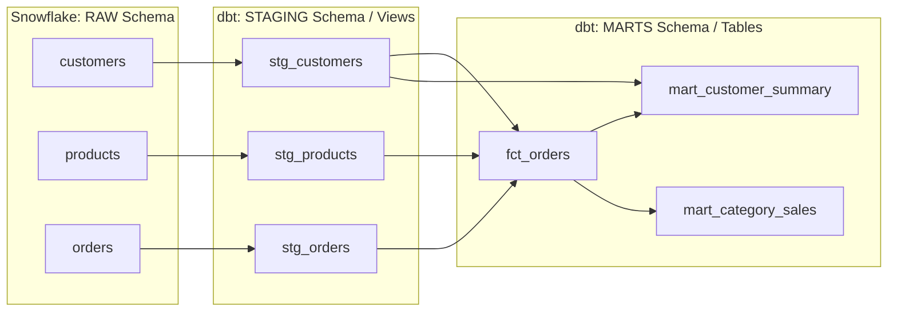

# 🛒 E-Commerce Data Engineering Pipeline (Snowflake + dbt)


An end-to-end Modern Data Stack (MDS) project that ingests raw e-commerce data into **Snowflake** and performs enterprise-grade transformations, quality testing, and documentation using **dbt (data build tool)**.

---

## 📌 Executive Summary

This pipeline converts raw transactional CSV feeds into analytics-ready data marts. It handles data cleaning, data type casting, deduplication, star-schema modeling, and automated data assertion testing.

- **Data Warehouse**: Snowflake (`ECOMMERCE_DB`)
- **Orchestration & Transformation**: dbt Core (`dbt-snowflake`)
- **Modeling Paradigm**: Staging (Views) ➔ Fact & Analytics Marts (Tables)

---

## 🏗 Architecture & Data Lineage



---

## 📁 Repository Structure

```text
ecommerce_dbt/
├── models/
│   ├── staging/
│   │   ├── stg_customers.sql       # Clean customer attributes
│   │   ├── stg_products.sql        # Clean product metrics
│   │   └── stg_orders.sql          # Order cleaning & deduplication
│   └── marts/
│       ├── fct_orders.sql          # Core Fact table (Orders + Revenue)
│       ├── mart_customer_summary.sql # Aggregated customer analytics
│       └── mart_category_sales.sql # Aggregated sales by product category
├── tests/
│   └── assert_completed_order_revenue_positive.sql # Custom SQL test
├── dbt_project.yml                 # dbt Project configuration
├── packages.yml                    # dbt Packages
└── README.md                       # Project Documentation
```

---

## 🗄️ Database Design (`ECOMMERCE_DB`)

| Schema | Type | Description |
| :--- | :--- | :--- |
| **`RAW`** | Tables | Ingested landing tables from source CSV files (`CUSTOMERS`, `PRODUCTS`, `ORDERS`). |
| **`STAGING`** | Views | Lightweight transformations, data cleaning, deduplication, and standardized column naming. |
| **`MARTS`** | Tables | Final dimensional tables, fact models, and aggregated business metrics for BI tools. |

---

## ⚡ Transformation Models & Business Logic

### 1. Staging Layer
- **`stg_customers`**: Standardizes email formats, formats customer names, trims whitespace.
- **`stg_products`**: Normalizes product categories and casts prices to numeric formats.
- **`stg_orders`**: Applies window functions (`ROW_NUMBER() OVER (PARTITION BY order_id ORDER BY order_date DESC)`) to purge duplicate order entries.

### 2. Marts Layer
- **`fct_orders`**:
  - Grain: 1 row per order.
  - Calculated Field: `total_amount = quantity * price`.
  - Enriches orders with customer details and product metadata using `dbt ref()`.
- **`mart_customer_summary`**:
  - Aggregates total orders placed and total monetary spend per customer.
  - Filtered specifically on `completed` order statuses for accurate financial tracking.
- **`mart_category_sales`**:
  - Summarizes total order volume and total revenue generated grouped by product category.

---

## 🧪 Data Quality & Testing Framework

The pipeline enforces data reliability via **10 data quality assertions** executed on every build:

1. **Primary Key Constraints**: Uniqueness and Non-Null tests on `customer_id`, `product_id`, and `order_id`.
2. **Referential Integrity**: Validates foreign key references between orders, customers, and products.
3. **Accepted Values**: Restricts `order_status` strictly to `['completed', 'shipped', 'pending', 'cancelled']`.
4. **Custom SQL Business Rule (`assert_completed_order_revenue_positive.sql`)**: Ensures that all completed orders generate a positive revenue value (`total_amount > 0`).

---

## 🚀 How to Run the Project Locally

### Prerequisites
- Python 3.9+
- Snowflake Account credentials
- dbt Core installed (`dbt-snowflake`)

### Execute Pipeline Commands
```bash
# 1. Run transformation models
dbt run

# 2. Run data quality tests
dbt test

# 3. Generate and view interactive lineage graph
dbt docs generate
dbt docs serve
```

---

## 🔄 Rerun Strategy for Incremental Data

When new order feeds arrive from upstream transactional databases:
1. **Ingest**: Load new CSV/stream batches into `RAW.ORDERS` table in Snowflake.
2. **Transform**: Execute `dbt run` — `stg_orders` automatically deduplicates incoming batches via windowing, downstream tables (`fct_orders` and summary marts) recalculate seamlessly.
3. **Audit**: Execute `dbt test` to ensure zero quality regressions before serving downstream dashboards.

---

## 👨‍💻 Author

- **Data Engineer**: Student
- **University**: PUA
